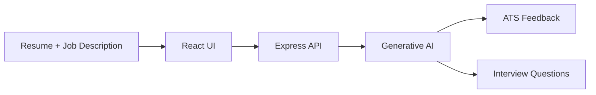
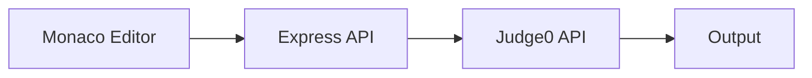

```
  ____     _     _   _  ____      _    __     __
 / ___|   / \   | | | ||  _ \    / \   \ \   / /
| |  _   / _ \  | | | || |_) |  / _ \   \ \ / / 
| |_| | / ___ \ | |_| ||  _ <  / ___ \   \ V /  
 \____|/_/   \_\ \___/ |_| \_\/_/   \_\   \_/   
```

### 👋 Hi, I'm Gaurav Chaubey, a Full-Stack (MERN) Developer

I build secure web apps with **React, Node.js, Express and MongoDB**, and add **AI features** to them.

```bash
$ whoami
Gaurav Chaubey

$ cat about.txt
Education : BCA, Babu Banarasi Das University (CGPA 8.54)
Rank      : AIR 44 in AINCAT 2026 (4 Lakh+ participants)
DSA       : 850+ problems solved (CodeChef + LeetCode)
Location  : Lucknow (open to Noida / Bengaluru)
Status    : Open to full-stack roles at product-based companies 🚀
```

---

## 📬 Contact

- 📧 **Email:** [gauravchaubey292003@gmail.com](mailto:gauravchaubey292003@gmail.com)
- 💼 **LinkedIn:** [Connect with me](https://www.linkedin.com/in/YOUR_LINKEDIN_ID)
- 🧩 **LeetCode:** [Profile](https://leetcode.com/u/YOUR_LEETCODE_ID) (200+ solved)
- 👨‍🍳 **CodeChef:** [Profile](https://www.codechef.com/users/YOUR_CODECHEF_ID) (650+ solved)

---

## 🧰 Tech Stack

| Area | Technologies |
|:--|:--|
| **Languages** | Java, Python, JavaScript, SQL, HTML, CSS |
| **Frontend** | React.js |
| **Backend** | Node.js, Express.js, REST APIs |
| **Database** | MongoDB, Redis |
| **Cloud / DevOps** | AWS (EC2, S3, Lambda, DynamoDB), Docker, CI/CD, Git |
| **Fundamentals** | DSA, OOP, Operating Systems, DBMS, Computer Networks |

---

## 🚀 Projects

### 🧠 AI Resume Analyzer & Interview Assistant
`MERN` `Generative AI` `JWT` `Helmet.js`

Checks a resume against a job description and tells the candidate what skills are missing.



- 📈 **40%+ better ATS match accuracy**
- 🎤 Generates **10+ interview questions** (technical + HR)
- 🔐 Secured with **JWT + token blacklisting**, **Helmet.js** and **rate limiting** (100 requests / 15 min)

### 💻 Codify: Online Code Editor & Compiler
`MERN` `Monaco Editor` `Judge0 API`

Write and run code in the browser, just like an online IDE.



- ⚡ Runs **20+ languages** in **under 2 seconds**
- 💾 Save your snippets in a personal dashboard
- 🔐 Login with **JWT + bcrypt**, fully responsive UI

---

## 🏆 Achievements

| Contest | Rank | Participants |
|:--|:--:|:--:|
| **AINCAT 2026** | 🥇 **44** | 4 Lakh+ |
| **AINCAT 2025** | **452** | 4.7 Lakh+ |
| **Naukri Campus Young Turks 2025** | **1842** | 5 Lakh+ |

## 📜 Certifications

- **Python for Data Science, AI & Development**: IBM (Coursera)
- **Full Stack Developer Bootcamp**: GeeksforGeeks
- **Networking Basics**: Cisco Networking Academy

---

## 🎯 Looking For

Full-stack / MERN developer roles at product-based companies in **Noida, Bengaluru** or remote.

**Let's talk:** [gauravchaubey292003@gmail.com](mailto:gauravchaubey292003@gmail.com)
